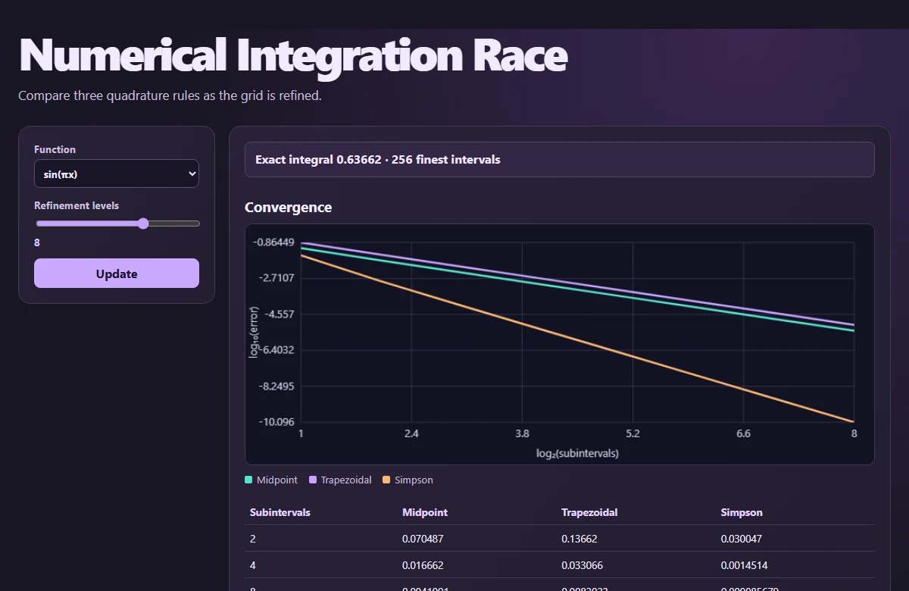

# Numerical Integration Race

Compare three quadrature rules as the grid is refined.

[Open the web app](https://surfingcoder.com/apps/numerical-integration-race/)



## Run locally

Serve the repository with Python 3, then open http://127.0.0.1:8000/ in a current browser.

```sh
python -m http.server 8000 --bind 127.0.0.1
```

Start with the provided example. Adjust the controls and select **Update** to recompute. Sliders refresh the result as you move them.

## Method

Composite midpoint, trapezoidal and Simpson’s rules integrate over [0, 1]. The error plot uses base-10 logarithms and floors round-off-level errors at 10⁻¹⁵.

## Verify

Run `node --test check.mjs` with Node.js 22 or newer. The check runs the app’s mathematical regression cases without a browser.
